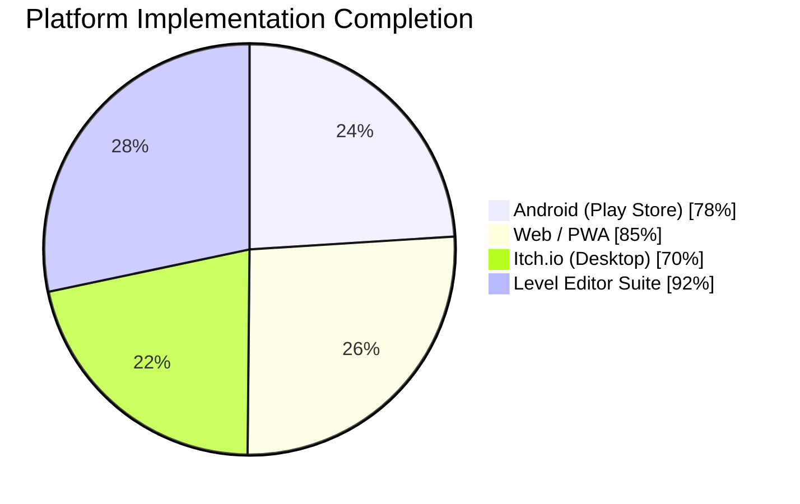
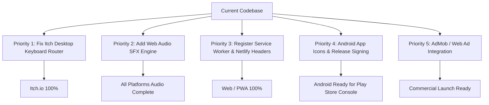

# Cross-Platform Implementation & Platform Readiness Report
**Project:** Grid Leap (`com.olaidigitalstudios.gridleap`)  
**Scope:** Comprehensive Codebase Inspection, Build Pipeline Verification & Gap Analysis  
**Date:** September 2026  

---

## Executive Summary & Completion Dashboard

Grid Leap has a unified codebase capable of targeting four distinct deployment modes via Vite environment flags (`VITE_APP_TARGET`): **Android (Google Play Store)**, **Web (PWA / Browser)**, **Itch.io (Desktop HTML5)**, and **Editor (Creator Suite)**.

The core game logic, 100-level campaign, interactive tutorial, daily challenge generator, and UI state architecture are complete and verified by automated BFS solvers. However, readiness varies across each platform depending on native SDKs, input handling, and platform-specific assets.

### Overall Completion Scorecard

| Platform Target | Build Target | Output Dir | Completion | Status | Primary Blocker / Gap |
|---|---|---|:---:|:---:|---|
| **Android (Play Store)** | `npm run build:playstore` | `android/` | **78%** | Working Debug APK | Default stock icons/splash, missing AdMob SDK, debug-only signing |
| **Web / PWA** | `npm run build:web` | `dist/web` | **85%** | Production Ready | `sw.js` not registered, missing `_headers` cache rules, no audio |
| **Itch.io (Desktop)** | `npm run build:itch` | `dist/itch` | **70%** | Playable with bugs | **Input bug:** WASD/Z/R/H not wired in input router (`D` opens Dev mode) |
| **Level Editor & Dev** | `npm run build:editor` | `dist/editor` | **92%** | Highly Mature | Custom level editor unsaved on refresh (no local auto-save) |
| **Core Gameplay Engine**| Shared (`src/core/`) | Cross-platform | **95%** | Complete & Tested | **Audio system is 0%** (settings toggle exists, 0 sound files) |

---

## 1. Platform Analysis: Android (Google Play Store) — 78% Complete

### Current Status: Working Debug APK Verified
- **Build Command:** `npm run build:playstore && cd android && .\gradlew.bat assembleDebug`
- **Output:** `android/app/build/outputs/apk/debug/app-debug.apk` (4.2 MB)
- **Engine / Wrapper:** Capacitor v8.5.1 on Android API 36 (`compileSdkVersion 36`, `targetSdkVersion 36`, `minSdkVersion 24`).

### What Is Implemented & Working (78%)
1. **Native Capacitor Plugins Configured:**
   - `@capacitor/app@8.1.1`: Listens to native `appStateChange` for lifecycle pauses and minimizes the app when pressing back from the Home Hub.
   - `@capacitor/haptics@8.0.2`: Triggers native haptics on player leaps (Light impact), dead-end states (Warning notification), and level completion (Success notification).
   - `@capacitor/status-bar@8.0.3`: Sets dark status bar style with background color `#0B131A` to match the game's dark theme.
2. **Hardware Back Button Hierarchy:**
   - In `src/main.js`, a 5-tier hardware back button contract is implemented:
     1. Closes open modal overlay (Rules, Pause, Settings, Out-of-Lives).
     2. Exits custom playtest back to Level Designer.
     3. Returns from active puzzle to Home Hub.
     4. Returns from Level Designer to Home Hub.
     5. Minimizes the native Android activity when pressed on Home Hub (`App.minimizeApp()`).
3. **Target UI Adaptation:**
   - In `playstore` mode, `src/main.js` cleanly strips out dev features: hides the mode pill, hides dev diagnostics, hides editor launcher cards, and hides the dev playtest bar.
4. **Orientation Lock:**
   - `android/app/src/main/AndroidManifest.xml` enforces `android:screenOrientation="portrait"`.

### What Is Missing / Incomplete for Google Play Release (22%)
1. **Stock Icons & Splash Screens:**
   - `android/app/src/main/res/mipmap-*` still uses the stock default Capacitor robot icons and default splash screens. Needs generation of Android Adaptive Icons (`ic_launcher` and `ic_launcher_round`) from `public/icon.svg`.
2. **AdMob SDK Integration (Missing):**
   - In the DOM, `#adBannerSlot` and the Out of Lives button `#outOfLivesWatchAdBtn` ("Watch Ad +1 ❤️") are defined, but **no AdMob plugin is installed**. `@capacitor-community/admob` is needed to show Google AdMob banner ads and rewarded interstitial videos.
3. **Release Keystore & AAB Packaging:**
   - No release signing configuration exists in `android/app/build.gradle`. Google Play requires an Android App Bundle (`.aab`) signed with a release keystore via `bundleRelease`.
4. **Missing Sound / Audio:**
   - No audio assets or sound synthesis exist. An Android mobile game without audio feedback on tile jumps feels incomplete to players.

---

## 2. Platform Analysis: Web / PWA — 85% Complete

### Current Status: Production Ready Static Build
- **Build Command:** `npm run build:web`
- **Output:** `dist/web/`
- **Footprint:** 89.43 KB uncompressed (22.40 KB Brotli compressed wire size).

### What Is Implemented & Working (85%)
1. **Responsive Viewport & DOM:**
   - Constrained 480px portrait mobile shell that scales gracefully to desktop and tablet viewports.
2. **Full Offline Game Content:**
   - All 100 levels, BFS solver algorithm, hints, and local persistence run 100% in-browser without calling external APIs.
3. **Daily Challenge System:**
   - `src/state/daily-manager.js` features a date-seeded deterministic procedural generator with streak tracking and online connectivity verification.
4. **Web Visibility API Integration:**
   - `src/platform/lifecycle.js` auto-saves game state when the browser tab is hidden or minimized.
5. **Web Haptics Fallback:**
   - Calls `navigator.vibrate([10])` on Android Chrome/Firefox browsers when native Capacitor is unavailable.
6. **Dual Visual Themes:**
   - Theme toggle button allows switching between Obsidian (Dark) and Vellum (Light) with CSS variable palettes.

### What Is Missing / Incomplete for Web (15%)
1. **Service Worker Not Registered:**
   - An offline service worker file `public/sw.js` exists, but is **never registered** in `index.html` or `main.js`. Registering it is required for true PWA offline installability.
2. **Missing Netlify / CDN Caching Headers:**
   - No `_headers` or `netlify.toml` file exists. Without it, browsers perform 304 conditional HTTP revalidation requests on every return visit rather than reading immutable assets directly from disk cache.
3. **Open Graph & SEO Meta Tags:**
   - `index.html` lacks Open Graph (`og:title`, `og:image`, `og:description`), Twitter Card metadata, and a standard `<link rel="icon">` (only `manifest.json` is linked).

---

## 3. Platform Analysis: Itch.io / Desktop HTML5 — 70% Complete

### Current Status: Playable, but Input Divergence Needs Fix
- **Build Command:** `npm run build:itch`
- **Output:** `dist/itch/`

### What Is Implemented & Working (70%)
1. **Fullscreen Toggle:**
   - `#gameFullscreenBtn` is activated (`TargetConfig.features.fullscreenControl = true`) and triggers `document.documentElement.requestFullscreen()`.
2. **Desktop Key Legend Overlay:**
   - A legend pill displays below the grid: `[Arrows / WASD] Move • [Z] Undo • [R] Restart • [T] Trail • [H] Hint`.
3. **Mouse Navigation:**
   - Clicking legal destination cells triggers immediate leap movement.
4. **Dev UI Gating:**
   - Developer mode pills, level editor hub cards, and diagnostics are hidden in consumer Itch builds.

### What Is Missing / Broken for Itch.io (30%)
1. **CRITICAL INPUT BUG in `src/scenes/input-router.js`:**
   - The on-screen key legend promises `[Arrows / WASD] Move • [Z] Undo • [R] Restart • [H] Hint`.
   - **However, in code:**
     - Keys `W`, `A`, `S` are **not mapped** in the `keydown` listener!
     - Key `D` is mapped to **`onToggleDev()`**, so pressing `D` to move right opens the Developer Diagnostics modal instead of moving the token!
     - Keys `Z` (Undo), `R` (Restart), and `H` (Hint) are **not mapped** in `keydown`!
   - *Fix needed:* Map WASD to directional movement, bind `Z` to `undo()`, `R` to `restart()`, `H` to `toggleSolutionPath()`, and move the Dev mode key strictly to Backtick (`` ` ``).
2. **Packaging Automation:**
   - No script exists to zip `dist/itch` into an itch-ready zip file (e.g. `npm run pack:itch`).
3. **No Audio:**
   - Desktop web puzzle players expect audio feedback for clicks and leaps.

---

## 4. Platform Analysis: Level Designer & Dev Suite — 92% Complete

### Current Status: Highly Mature & Fully Functional
- **Build Command:** `npm run build:editor` / `npm run dev:editor`
- **Output:** `dist/editor/`

### What Is Implemented & Working (92%)
1. **Interactive Visual Canvas:**
   - Grid size steppers supporting 3×3 up to 8×8 grids.
   - Brush palette supporting numbers 1–7, Gap (0), Start position, and Goal position.
2. **Live BFS Solver Diagnostics:**
   - Solvability verification, optimal move calculation, decoy path counter, trap depth counter, and average branching load.
   - Live step-by-step path breadcrumb display (`[0,0] → [0,2] → [2,2]`).
3. **Dev Playtest & Stepper Engine:**
   - Instant "TEST PLAY ▶" launches the created level in the real game board with full movement rules, and a "Back to Editor" button to resume design.
   - Stepper bar with Step Forward (`]`), Step Backward (`[`), Auto-Play (`Space`), and Reset.
4. **Import / Export Engine:**
   - JSON export and import modal with one-click copy to clipboard.
   - Shipped level remixer: Can load any of the 100 campaign levels directly into the editor for modifying.

### What Is Missing / Incomplete for Editor (8%)
1. **Local Auto-Save:**
   - If the browser refreshes while designing, unsaved canvas changes are lost. An autosave to `localStorage.setItem("grid_leap_editor_draft")` is missing.
2. **Editor Undo / Redo:**
   - `Ctrl+Z` undo stack for tile painting within the grid canvas does not exist.

---

## 5. Cross-Cutting Systems Audit

### Core Gameplay & Puzzle Engine: 95%
- **Rules Engine (`src/core/rules.js`):** Exact-distance cardinal jumps, boundary filtering, dead-end detection, and goal validation are complete and robust.
- **BFS Solver (`src/core/solver.js`):** Validates shortest paths, difficulty ratings, trap depths, and branching metrics.
- **Content (`src/data/levels.js`):** 100 handcrafted & algorithmic levels across 10 thematic chapters (Origins, Planning, Deceptive, Multi-Step, etc.). All 100 levels pass automated BFS validation.
- **Tutorial (`src/scenes/tutorial-controller.js`):** 10 interactive micro-levels embedded in the How-to-Play modal with curved trajectory arcs.

### Audio & Sound System: 0% (Universal Gap)
- In `src/state/persistence.js` and `src/scenes/game-renderer.js`, a `Sound Effects` toggle exists in the Settings UI.
- **Zero audio files or Web Audio API code exist.** There are no sound effects for leaps, invalid moves, undo, resets, or stage clears. This is the single biggest sensory gap across all platforms.

### Monetization & Ads: 10% (Placeholder Only)
- In `index.html`, an `#adBannerSlot` (56px) and an `#outOfLivesWatchAdBtn` ("Watch Ad +1 ❤️") exist in the UI markup.
- No ad provider SDK (AdMob, Google AdSense, Poki, or CrazyGames) is integrated. Clicking "Watch Ad" currently does not load an ad.

---

## Prioritized Action Plan to Reach 100%

### 1. High Priority (Bugs & Release Blockers)
1. **Fix Itch / Desktop Keyboard Router:**
   - Update `src/scenes/input-router.js` to support `KeyW`, `KeyA`, `KeyS`, `KeyD` for movement, `KeyZ` for Undo, `KeyR` for Restart, and `KeyH` for Hint. Move Dev mode toggle exclusively to Backtick (`` ` ``).
2. **Generate Android Icons & Splash Screens:**
   - Replace stock Capacitor mipmaps with adaptive icons generated from `public/icon.svg`.
3. **Register Service Worker:**
   - Add `navigator.serviceWorker.register('/sw.js')` to `src/main.js` to activate full offline PWA caching.
4. **Add Netlify `_headers` File:**
   - Add `public/_headers` with `Cache-Control: public, max-age=31536000, immutable` for `/assets/*` to eliminate 304 request overhead.

### 2. Medium Priority (Polish & Audio)
5. **Implement Lightweight Web Audio Synthesizer:**
   - Implement an audio synthesizer using the Web Audio API (`AudioContext`) with synthesized retro/clean tones (jump blip, invalid thud, level victory chord) so no heavy sound files need to be downloaded.
6. **Configure Android Release Signing:**
   - Add a `release` signing config block to `android/app/build.gradle` and a script `"build:bundle": "npm run build:playstore && cd android && .\\gradlew.bat bundleRelease"` in `package.json`.

### 3. Monetization (Commercial Launch)
7. **Integrate Ad Network:**
   - For Android: Install `@capacitor-community/admob` and hook up banner and rewarded video ads.
   - For Web/Itch: Hook up HTML5 ad providers (AdSense / Poki / CrazyGames) when distributing on web portals.
